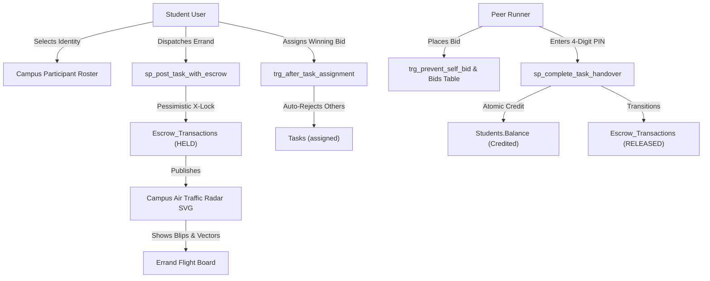

# Campus Errand Dispatcher — Frontend Architecture & User Guide

The frontend for the **Peer-to-Peer Campus Task & Errand Dispatcher** has been implemented as a high-concurrency, glassmorphic **Air Traffic Control** web application. It integrates directly with the MySQL 8.0 InnoDB database layer and FastAPI application to deliver live flight path tracking, relational escrow isolation, cryptographic 4-digit PIN handovers, and real-time ACID telemetry.

---

## 1. Visual Walkthrough & UI Showcase

````carousel

<!-- slide -->

<!-- slide -->

<!-- slide -->

````

---

## 2. Core Functional Modules



### Module Breakdown

| Component | File | Responsibilities |
| :--- | :--- | :--- |
| **Air Traffic Radar** | [`frontend/radar.js`](file:///Users/rajveermodi/Documents/GitHub/p2p-campus-task-dispatcher/frontend/radar.js) | Interactive SVG canvas rendering VIT campus landmarks (Food Mall, Tech Tower, Library, SJT, Hostels), rotating sweep beam, pulsating beacon rings, and animated flight path arcs with bounty chips. |
| **Tactical Audio Synthesizer** | [`frontend/audio.js`](file:///Users/rajveermodi/Documents/GitHub/p2p-campus-task-dispatcher/frontend/audio.js) | Pure Web Audio API procedural sound engine generating air-traffic pings, button clicks, dispatch radio tones, and escrow release chords without external audio file dependencies. |
| **Application Controller** | [`frontend/app.js`](file:///Users/rajveermodi/Documents/GitHub/p2p-campus-task-dispatcher/frontend/app.js) | Client-side reactive state manager handling student switcher, task creator, bidding, assignment resolution, PIN verification modals, and real-time polling (every 4s). |
| **Glassmorphic Design System** | [`frontend/style.css`](file:///Users/rajveermodi/Documents/GitHub/p2p-campus-task-dispatcher/frontend/style.css) | Custom Vanilla CSS tokens, obsidian dark mode (`#070b13`), aviation cyan (`#00e5ff`), neon emerald (`#10b981`), amber warnings, and micro-animations. |
| **Semantic Shell** | [`frontend/index.html`](file:///Users/rajveermodi/Documents/GitHub/p2p-campus-task-dispatcher/frontend/index.html) | SEO-optimized, accessible HTML5 layout with Google Fonts (`Outfit`, `Inter`, `JetBrains Mono`). |

---

## 3. End-to-End User Workflows Supported

1. **Student Persona Simulation:**
   * Click the student profile card in the top navigation bar to open the **Campus Participant Roster**.
   * Switch between registered students (`Rajveer Modi`, `Yajas AB`, `Abhayadev RVM`, `Ananya Sharma`, `Karthik Raman`, and `Rohan Verma`).
   * Live balance display dynamically updates with wallet funds and trust ratings.
   * Deposit simulated funds (₹100, ₹250, ₹500, ₹1000) for testing edge-cases.

2. **Errand Dispatch & Escrow Isolation:**
   * Select pickup and drop landmarks from campus hotspots.
   * Set bounty amount and 4-digit completion PIN (or click 🎲 Random).
   * Submitting executes `sp_post_task_with_escrow`, atomically checking balances via `SELECT ... FOR UPDATE`, deducting funds, creating the task, and locking bounty into `Escrow_Transactions`.

3. **High-Concurrency Bidding & Self-Bid Defense:**
   * Peer runners place bids via the **"⚡ Place Runner Bid"** button.
   * If a requester attempts to bid on their own errand, MySQL trigger `trg_prevent_self_bid` intercepts the insert with error code `45000`, displayed cleanly in the UI.
   * Duplicate bids by the same runner are blocked by candidate key `uq_task_runner`.

4. **1-Click Runner Assignment & Bid Resolution:**
   * When inspecting an errand posted by the active student, all submitted runner bids are listed with timestamps, ratings, and statuses.
   * Clicking **"✓ Assign"** updates the task to `assigned`, triggering `trg_after_task_assignment` to accept the winning runner and reject competing bids.

5. **Cryptographic PIN Handover & Escrow Settlement:**
   * When acting as the assigned runner, click **"🔐 Deliver & Enter PIN"**.
   * Entering the 4-digit token calls `sp_complete_task_handover`.
   * Upon token match, funds move from `HELD` to `RELEASED` and are credited to the runner's wallet with success chimes and celebrations.
   * An incorrect PIN triggers SQLSTATE `45000` (`Authentication Failed: Invalid verification PIN`).

6. **Automated Refund & Abandonment Recovery:**
   * Requesters can click **"Refund"** on open/abandoned errands to execute `sp_refund_abandoned_task`, instantly releasing escrow funds back to their wallet balance.

---

## 4. Live Server Endpoints

* **Web Application UI:** [http://localhost:8000/](http://localhost:8000/)
* **Interactive Swagger Documentation:** [http://localhost:8000/docs](http://localhost:8000/docs)
* **System Health Check:** [http://localhost:8000/health](http://localhost:8000/health)
